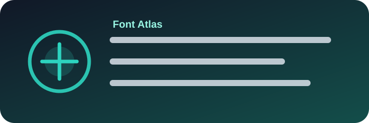

## 🧭 Overview
Inspect local TTF and OTF font metadata and generate a self-contained specimen page.. A small, local-first project designed to solve one focused problem with a simple workflow.

## ✨ Features
- 🔤 Read family, style, version, PostScript name, and glyph counts.
- 🧾 Generate a standalone HTML specimen for each selected font.
- 📎 Embed local font bytes in the report so it travels as one file.
- 🔒 All processing stays on your machine.

## 🖥️ Demo
~~~bash
python main.py examples --output font-atlas.html
~~~
The demo uses local sample input. No hosted service or external account is required.

## 🚀 Quick Start
~~~bash
git clone https://github.com/CyberLoop-dev/font-atlas.git
cd font-atlas
python main.py examples --output font-atlas.html
~~~

## 🧰 Tech Stack
- Python 3.10+
- fontTools (TTFont)
- HTML and base64 from the standard library

## 🗂️ Folder Structure
~~~text
font-atlas/\n├── assets/icon.svg\n├── examples/\n├── tests/test_main.py\n├── LICENSE\n├── README.md\n├── main.py\n└── requirements.txt
~~~

## 🗺️ Roadmap
- [ ] Add drag-and-drop folder selection in a small local web UI.
- [ ] Export a machine-readable JSON inventory.

## 🤝 Contributing
Bug reports and focused pull requests are welcome. Add or update tests when changing behavior, and keep the project easy to run locally.

## 📄 License
Released under the MIT License. See LICENSE.

